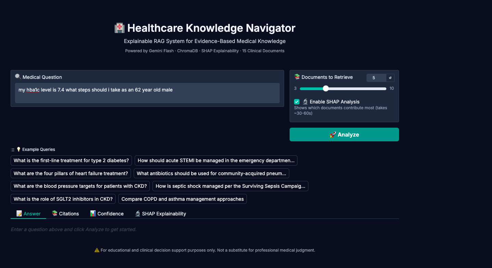
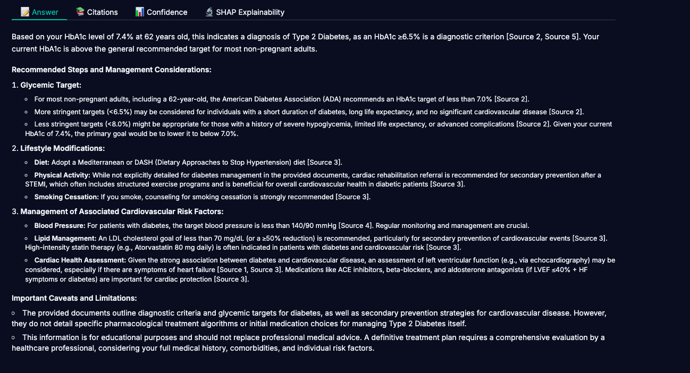
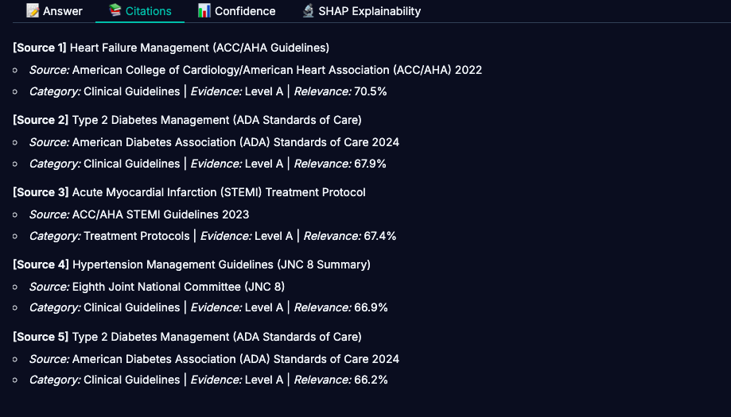
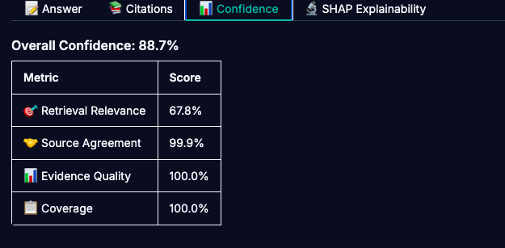
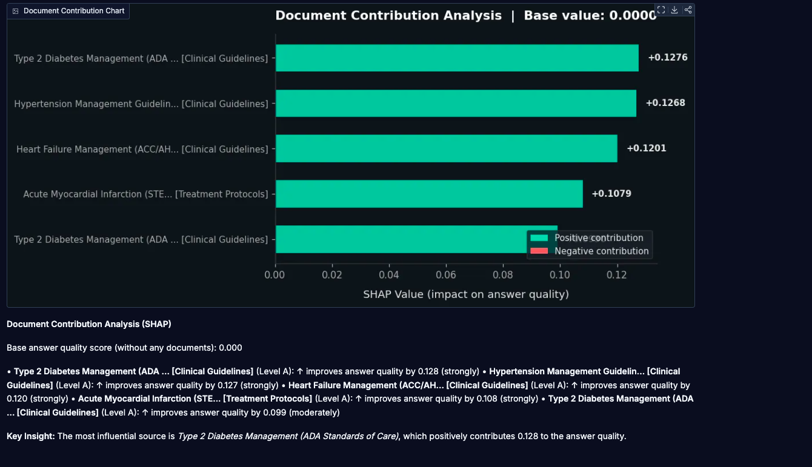
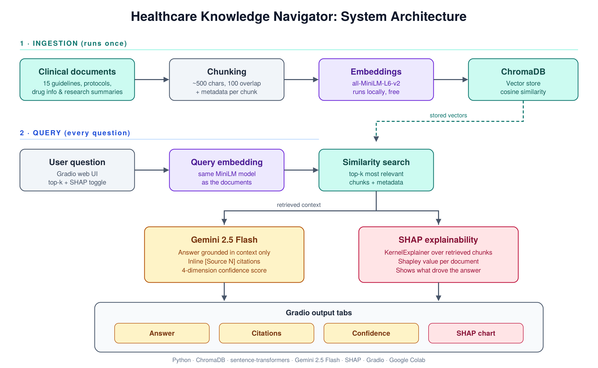

# Healthcare Knowledge Navigator

**An explainable RAG (Retrieval-Augmented Generation) assistant for evidence-based medical question answering.**

Ask a clinical question and the system retrieves the most relevant passages from a curated set of clinical guidelines, generates a **cited** answer with Google Gemini, scores its own confidence, and uses **SHAP** to show *which source documents drove the answer*.

> ⚠️ **Disclaimer:** Educational project only. Not a medical device and not for real clinical decisions. Always verify against current official guidelines.

---

## Demo







---

## Features

- Semantic search over 15 clinical documents (guidelines, treatment protocols, drug information, research summaries)
- Cited answers: claims are tagged `[Source N]` and mapped to their source documents
- Grounded generation: the model answers only from retrieved context and says so when evidence is insufficient
- Confidence scoring across four dimensions: retrieval relevance, source agreement, evidence quality, coverage
- SHAP explainability: Shapley values show each retrieved document's contribution to the answer
- Interactive Gradio UI with tabs for Answer, Citations, Confidence, and SHAP

---

## Project Architecture



---

## Tech Stack

| Component | Technology |
|---|---|
| Language | Python |
| Vector database | ChromaDB |
| Embeddings | sentence-transformers `all-MiniLM-L6-v2` (local) |
| LLM | Google Gemini 2.5 Flash (free tier) |
| Explainability | SHAP (KernelExplainer) |
| UI | Gradio |
| Runtime | Google Colab |

---

## Project Structure

```
healthcare-rag/
├── Healthcare_Knowledge_Navigator.ipynb   # Main Colab notebook
├── backend/                               # FastAPI RAG + SHAP engine
├── frontend/                              # Web UI (local version)
├── knowledge_base/                        # Sample medical documents
├── main.py                                # Local entry point
├── requirements.txt
├── screenshots/                           # Demo images
└── .env.example                           # API key template
```

---

## Limitations

- Small knowledge base (15 summarized documents)
- Summaries are for demonstration and may not reflect the latest guidelines
- Confidence scores are LLM self-assessed and not clinically validated
- SHAP values are approximated with limited samples to fit free-tier limits

## Future Work

- Ingest real PDFs (WHO, NICE, PubMed open-access papers)
- Domain-specific embeddings (e.g., BioBERT) and cross-encoder reranking
- Evaluate retrieval quality and answer faithfulness on a benchmark question set

---

## Author

**Aksh Gautam**
GitHub: [@Aksh-Gautam](https://github.com/Aksh-Gautam)